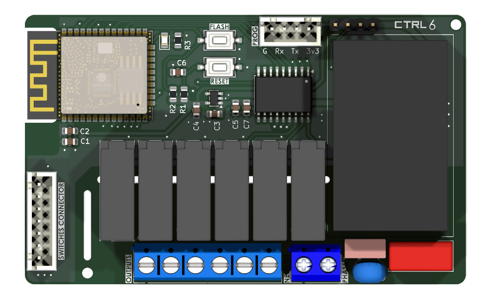
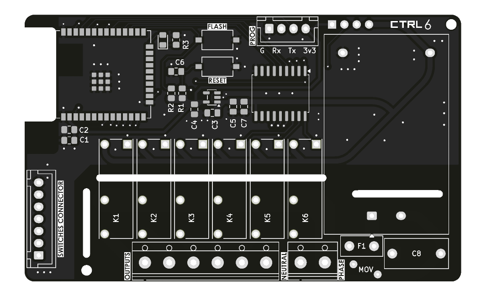
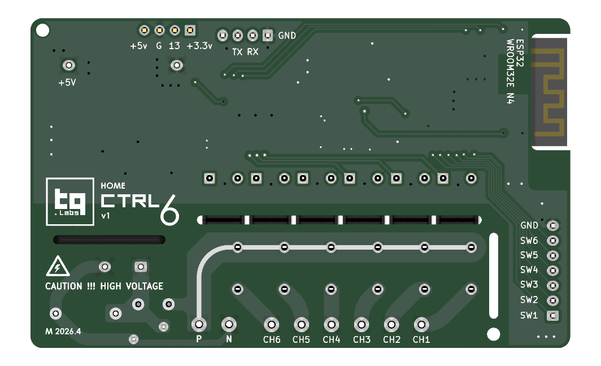
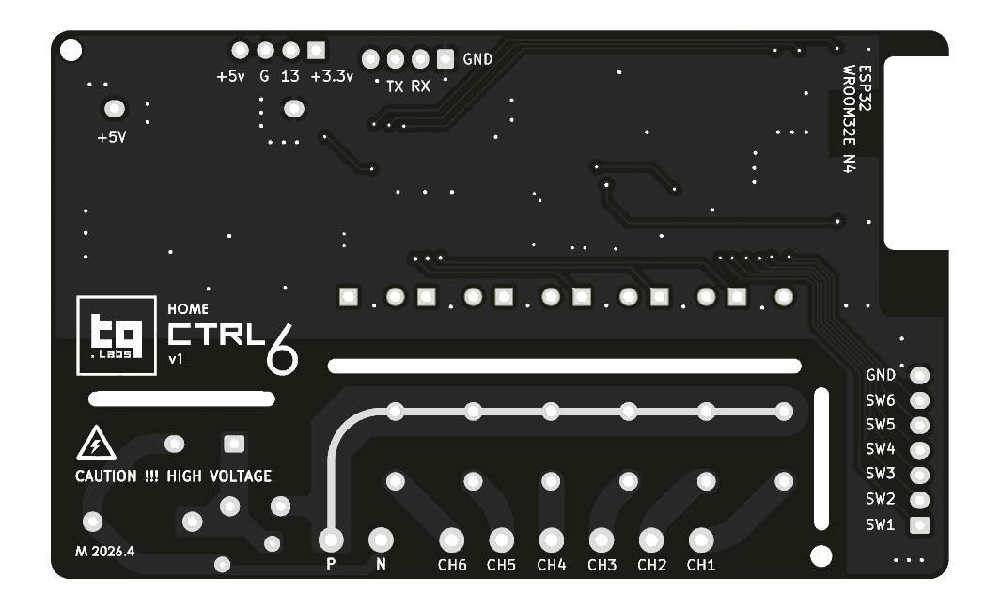
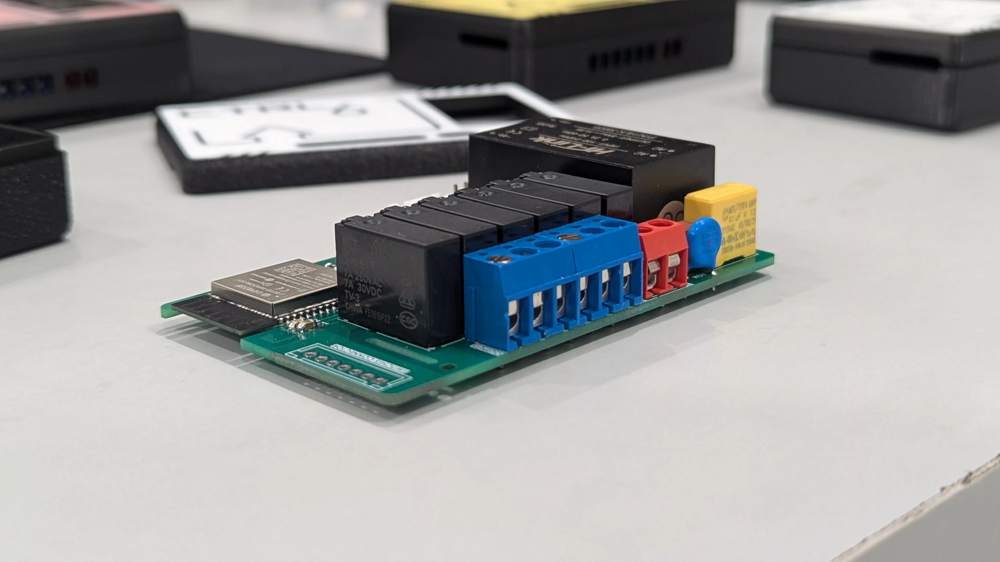
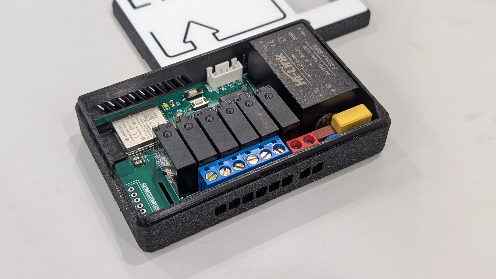
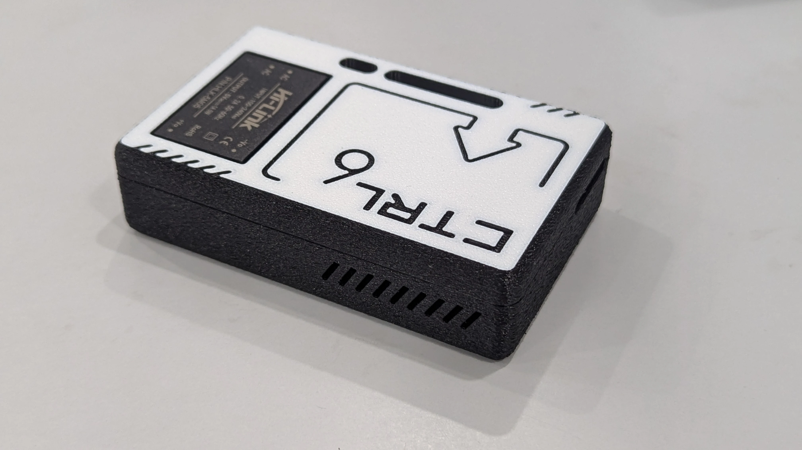
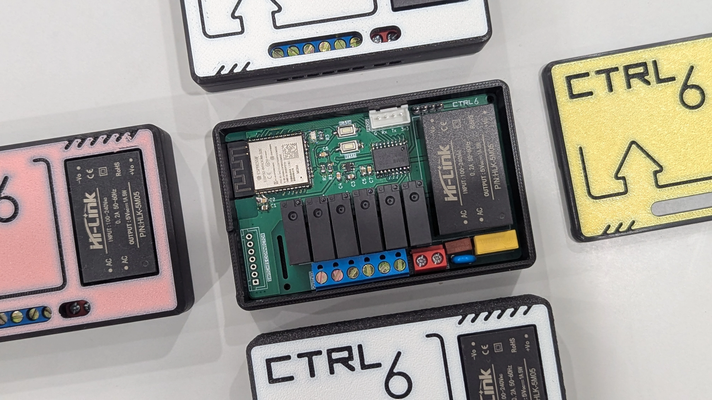

# CTRL6

ESP32-WROOM-32E based 6-channel mains relay controller. Powered directly from the mains via an HLK-5M05 AC/DC converter, it switches up to six 5A/250VAC loads with HF46F-005 relays and exposes flash/reset buttons plus six inputs on screw terminals.

## 🖼️ Renders

  <table>
    <tr>
      <td align="center" width="392"></td>
      <td align="center" width="392"></td>
    </tr>
    <tr>
      <td align="center">Top, assembled</td>
      <td align="center">Top, bare board</td>
    </tr>
  </table>

  <table>
    <tr>
      <td align="center" width="392"></td>
      <td align="center" width="392"></td>
    </tr>
    <tr>
      <td align="center">Bottom, assembled</td>
      <td align="center">Bottom, bare board</td>
    </tr>
  </table>

## 📷 Photos

  <table>
    <tr>
      <td align="center" width="392"></td>
      <td align="center" width="392"></td>
    </tr>
    <tr>
      <td align="center">Bare board</td>
      <td align="center">In the 3D printed enclosure</td>
    </tr>
  </table>

  <table>
    <tr>
      <td align="center" width="392"></td>
      <td align="center" width="392"></td>
    </tr>
    <tr>
      <td align="center">Closed</td>
      <td align="center">Lid colour variants</td>
    </tr>
  </table>

## 🧲 Useful Links

- [Interactive BOM](https://htmlpreview.github.io/?https://raw.githubusercontent.com/tqlabs-in/ctrl6/main/hardware/ibom.html)

## ⚖️ License

Licensed under [CERN-OHL-S-2.0](LICENCE).

Copyright (c) 2026 TQLabs. The CERN Open Hardware Licence is copyright CERN 2020 and is used unmodified.
